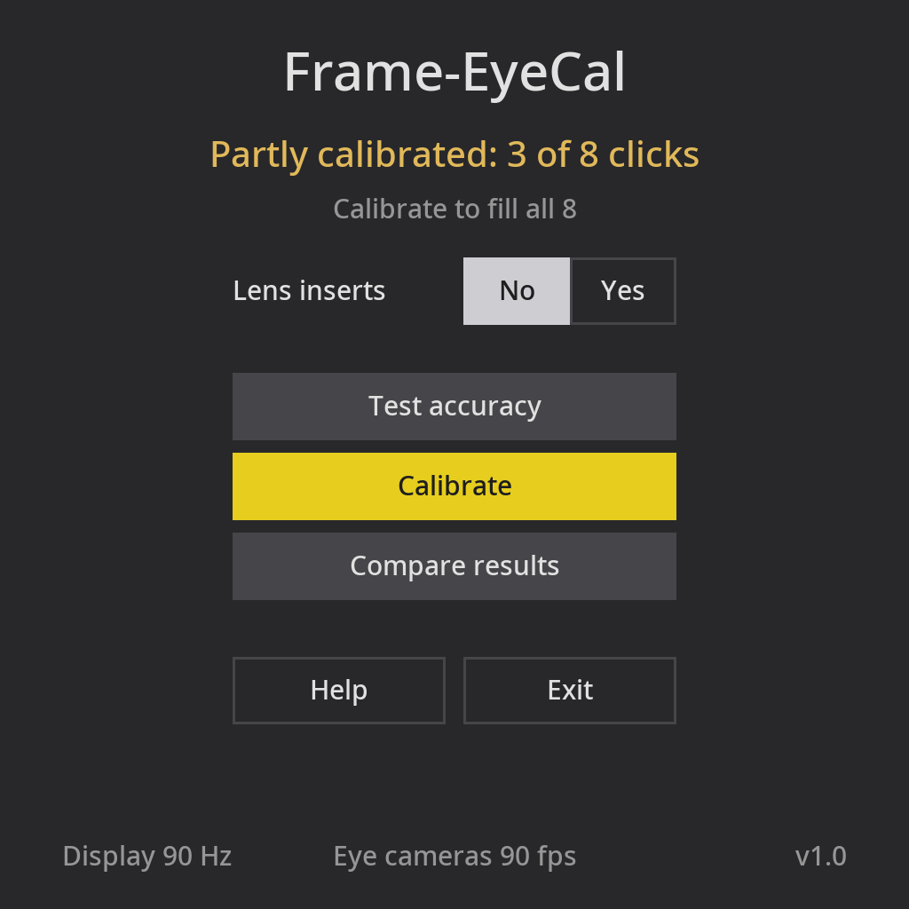
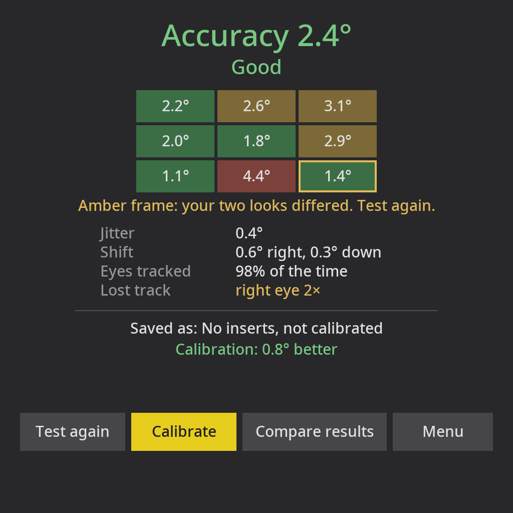
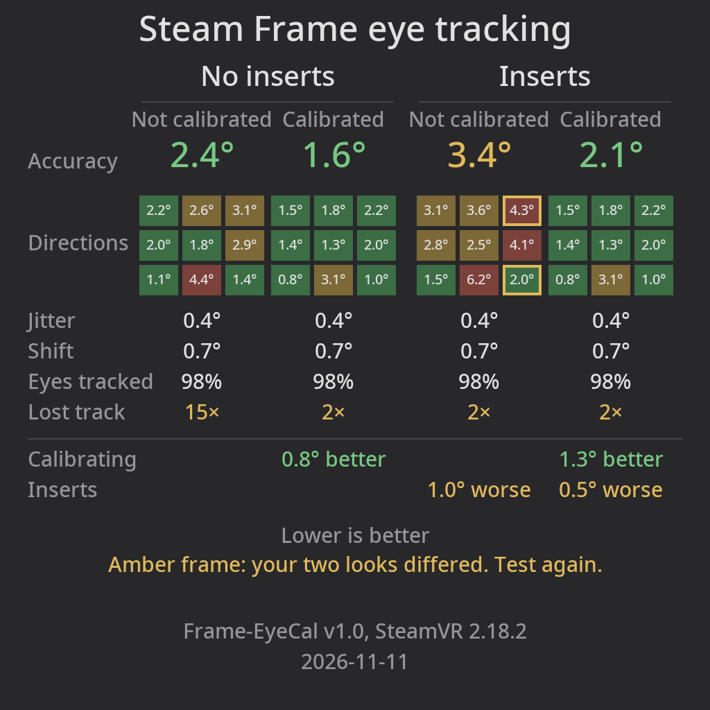

# Frame-EyeCal

[](https://github.com/Shark1nat0r/frame-eyecal/actions/workflows/build.yml)
[](https://github.com/Shark1nat0r/frame-eyecal/releases/latest)
[](LICENSE)
-1b2838)

Eye tracking calibration and accuracy test for the Steam Frame. Find out whether your eye tracking is
accurate, whether calibrating helps, and, if you use prescription lens inserts, whether they make it worse.

| Menu | Test result | Comparison (shareable image) |
|:-:|:-:|:-:|
|  |  |  |

<sub>Screens rendered with sample data (`EYECAL_PREVIEW`).</sub>

Not affiliated with or endorsed by Valve. Steam, SteamVR and Steam Frame are trademarks of Valve Corporation.

> [!IMPORTANT]
> This code was generated by AI and has not been reviewed by a human. The app has been tested thoroughly on a
> Steam Frame, but use it at your own risk.

## Tested on

SteamOS 0.4.5 (build 20261022.6150929) with SteamVR 2.18.2. Other versions may work but are untested.

## Install

In a Konsole window on the Frame:

```sh
curl -fsSL https://raw.githubusercontent.com/Shark1nat0r/frame-eyecal/main/install.sh | sh
```

Then start **Frame-EyeCal** from the SteamVR dashboard under **+**. A new entry can need a headset restart.
To update, run the same line again.

## Uninstall

```sh
~/.local/lib/frame-eyecal/uninstall.sh
```

This removes the app, your test results and the settings SteamVR stored for it.

## Use

- **Test accuracy:** look at a dot in 9 directions, each twice (about 45 seconds, no clicking). You get the error
  in degrees for each direction.
- **Calibrate:** point the laser at each square, look at the laser dot and click. The tracker keeps the
  last 8 good clicks until SteamVR restarts.
- **Compare:** test, calibrate and test again. If you use lens inserts, do this with and without them
  and set **Lens inserts** in the menu to match. A test only counts as "not calibrated" right after a
  SteamVR restart. Open the app with slow clicks then (hold the trigger half a second), or a dashboard
  click can count as calibration.
- **Fit:** results depend on how the headset sits on your face and change when you reseat it.

## How it works

The Frame's eye tracker calibrates itself from laser clicks on SteamVR menus and overlays, not from clicks
inside games: it assumes you looked at the point you clicked, and keeps the last 8 good clicks until SteamVR
restarts. Frame-EyeCal adds no calibration of its own. **Calibrate** collects 9 good clicks, so the tracker's
last 8 all come from it, and the test measures the result.

Valve does not document this; it was found by testing on SteamVR 2.18.2. On the Frame, SteamVR and its eye
tracker come with SteamOS, so any SteamOS update can change how it works. Each saved test records the
SteamVR version, and the comparison image shows it.

The app asks SteamVR for 90 Hz for itself only. Results are stored in `~/.local/share/frame-eyecal`.

## Build

GitHub Actions checks every push and pull request: `tools/lint.sh` (formatting, analyzers, unit tests) and the
arm64 build with its tests. A `v*` tag publishes a release. To build locally, run `./build.sh`
(podman, arm64 container).

## Development

- `src/`: `ui*` is the panel (`ui.cpp` behaviour, `ui_draw.cpp` the screens, `ui_preview.cpp` sample screens),
  `scene` the OpenXR test room. The parts that need no SteamVR are separate and unit-tested: `test_result`
  (result format, `results.txt`), `gaze_test` (scoring a test), `tracker_log` (the eye tracker's log), `link`,
  `geometry`.
- `tests/run.sh` builds and runs the unit tests natively, with AddressSanitizer and UBSan.
- `tools/lint.sh` checks formatting (clang-format, shfmt; `tools/lint.sh --fix` reformats), runs clang-tidy
  (`.clang-tidy`, bug and style checks; each disabled check is listed there with the reason), shellcheck, hadolint,
  semgrep (`.semgrep.yml` plus Semgrep's default, Trail of Bits and CWE Top 25 rulesets) and the tests.
  `tools/lint-deps.sh` installs the tool versions CI uses (`requirements-lint.txt`, shfmt) into `build/lint-tools`.
- Dependencies: the release bundles no third-party libraries; on the headset it uses SteamOS's and SteamVR's. The
  OpenVR SDK header is the only third-party code compiled in, and a weekly CI run reports new SDK releases and
  reruns the analyzers. Dependabot keeps the GitHub Actions and the lint tools current.
- Git hooks in `.githooks/`: before a commit `tools/lint.sh`; before a push `tools/check-updates.sh`, which stops the
  push while the OpenVR SDK, shfmt or a GitHub Action has a newer version (`git push --no-verify` skips it). Enable them once per clone:
  `git config core.hooksPath .githooks`
- `./preview.sh` renders every screen on the headset. `EYECAL_PREVIEW=<dir> build/frame-eyecal` does the same
  anywhere without SteamVR, given Noto Sans at `/usr/share/fonts/noto/` or DejaVu Sans at `/usr/share/fonts/TTF/`.

## License

MIT. Release builds include the OpenVR SDK header (BSD-3-Clause, see `LICENSE.openvr`).
